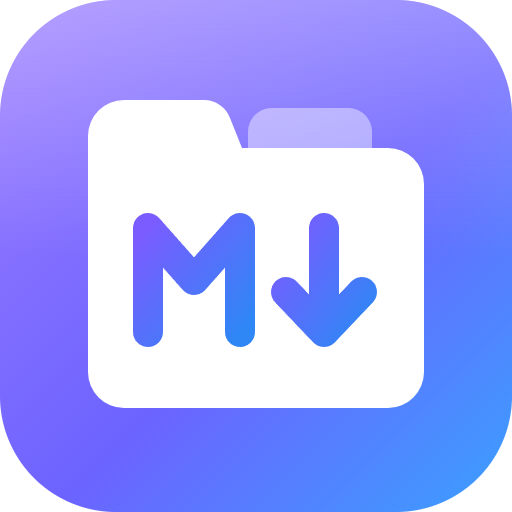
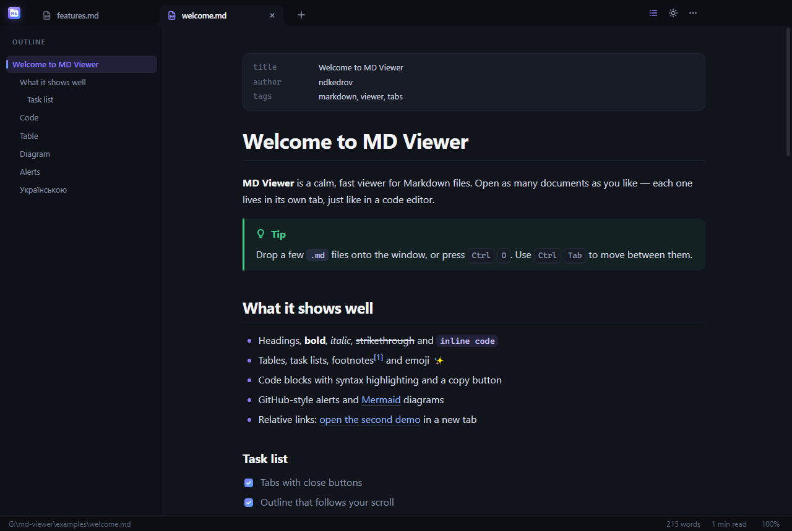
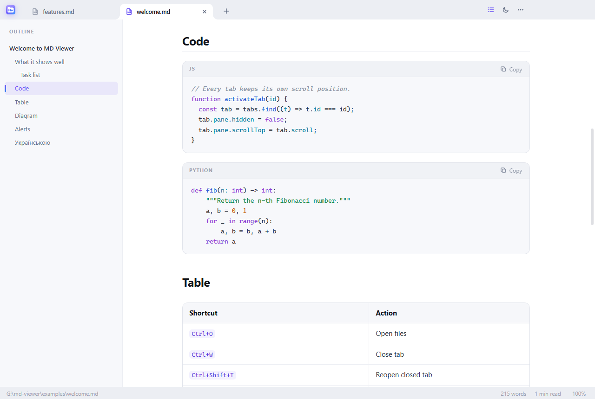

<p align="center">
  
</p>

<h1 align="center">MD Viewer</h1>

<p align="center">
  A beautiful Markdown viewer for Windows with tabs. Open as many <code>.md</code> files as you like.<br />
  Гарний переглядач Markdown для Windows із вкладками.
</p>

<p align="center">
  <a href="https://github.com/ndkedrov/md-viewer/releases/latest"><b>⬇ Download the installer</b></a>
</p>





## Features

- **Tabs**, like in a code editor: close button, middle click, drag to reorder, right-click menu
  (close others, close to the right, show in Explorer, copy path).
- **Outline** on the left that highlights the section you are reading.
- **Live reload**: save the file in any editor and the tab updates without losing your place.
- **GitHub-flavoured rendering**: tables, task lists, footnotes, emoji, front matter,
  `> [!NOTE]` alerts, syntax highlighting with a copy button, and **Mermaid** diagrams.
- **Relative links** open the linked `.md` file in a new tab; images next to the file just work.
- **Find in document** (`Ctrl+F`), text size (`Ctrl` + wheel), page width, print.
- **Light and dark themes** that follow Windows, or pick one yourself.
- **English and Ukrainian** interface, chosen from the system language.
- Remembers open tabs between launches; double-clicking a `.md` file opens it in the running window.
- Safe to open unknown files: scripts and other active content in documents are stripped.

## Keyboard shortcuts

| Keys                                   | Action                    |
| -------------------------------------- | ------------------------- |
| `Ctrl+O`                               | Open files                |
| `Ctrl+W` / middle click                | Close tab                 |
| `Ctrl+Shift+T`                         | Reopen closed tab         |
| `Ctrl+Tab` / `Ctrl+Shift+Tab`          | Next / previous tab       |
| `Ctrl+1` … `Ctrl+9`                    | Jump to tab               |
| `Ctrl+F`, `F3` / `Shift+F3`            | Find, next / previous     |
| `Ctrl+B`                               | Toggle outline            |
| `Ctrl+=` / `Ctrl+-` / `Ctrl+0`         | Text size                 |
| `F5`                                   | Reload file               |
| `Ctrl+P`                               | Print                     |

## Install

Download `MD-Viewer-Setup-x.y.z.exe` from [Releases](https://github.com/ndkedrov/md-viewer/releases/latest)
and run it. The installer lets you choose the folder, adds Start menu and desktop shortcuts, and registers
MD Viewer for `.md` / `.markdown` files (it appears in **Open with**).

> Windows SmartScreen may warn that the app is from an unknown publisher, because the installer
> is not code-signed. Click **More info → Run anyway**.

## Build from source

Requires [Node.js](https://nodejs.org) 20 or newer.

```bash
git clone https://github.com/ndkedrov/md-viewer.git
cd md-viewer
npm install
npm start -- examples/welcome.md   # run in development
npm run dist                       # build the installer into dist/
```

`npm run icon` regenerates `build/*.ico` and the PNG icons from the SVG sources.

Pushing a tag like `v1.0.1` builds the installer on GitHub Actions and attaches it to a release.

### Project layout

```
src/main/       Electron main process: window, files, watching, Markdown rendering
src/preload/    the small, safe API the page is allowed to use
src/renderer/   the interface: tabs, outline, find, themes (plain HTML/CSS/JS)
build/          icons and installer resources
examples/       demo documents
```

## Українською

**MD Viewer** — програма для зручного читання `.md` файлів. Відкривайте скільки завгодно документів:
кожен у своїй вкладці з хрестиком для закриття, як у текстовому редакторі.

- Зміст ліворуч підсвічує розділ, який ви читаєте.
- Файл оновлюється сам, щойно ви зберегли його в іншому редакторі.
- Таблиці, списки задач, підсвітка коду з кнопкою «Копіювати», діаграми Mermaid, блоки `> [!NOTE]`.
- Світла й темна теми, інтерфейс українською.

**Встановлення:** завантажте `MD-Viewer-Setup-x.y.z.exe` зі сторінки
[Releases](https://github.com/ndkedrov/md-viewer/releases/latest) і запустіть. Якщо Windows покаже
попередження SmartScreen, натисніть **Докладніше → Виконати все одно** (інсталятор не підписаний сертифікатом).

## License

[MIT](LICENSE)
