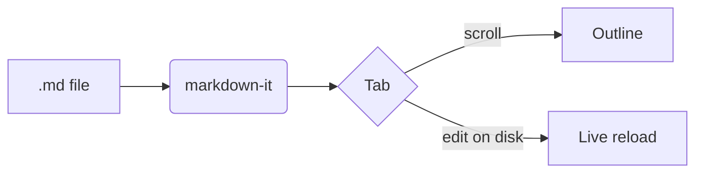

# Welcome to MD Viewer

**MD Viewer** is a calm, fast viewer for Markdown files. Open as many documents as
you like — each one lives in its own tab, just like in a code editor.

> [!TIP]
> Drop a few `.md` files onto the window, or press <kbd>Ctrl</kbd> <kbd>O</kbd>.
> Use <kbd>Ctrl</kbd> <kbd>Tab</kbd> to move between them.

## What it shows well

- Headings, **bold**, *italic*, ~~strikethrough~~ and `inline code`
- Tables, task lists, footnotes[^1] and emoji :sparkles:
- Code blocks with syntax highlighting and a copy button
- GitHub-style alerts and [Mermaid](https://mermaid.js.org) diagrams
- Relative links: [open the second demo](features.md) in a new tab

### Task list

- [x] Tabs with close buttons
- [x] Outline that follows your scroll
- [x] Live reload when the file changes on disk
- [ ] Your next great document

## Code

```js
// Every tab keeps its own scroll position.
function activateTab(id) {
  const tab = tabs.find((t) => t.id === id);
  tab.pane.hidden = false;
  tab.pane.scrollTop = tab.scroll;
}
```

```python
def fib(n: int) -> int:
    """Return the n-th Fibonacci number."""
    a, b = 0, 1
    for _ in range(n):
        a, b = b, a + b
    return a
```

## Table

| Shortcut              | Action                    |
| --------------------- | ------------------------- |
| `Ctrl+O`              | Open files                |
| `Ctrl+W`              | Close tab                 |
| `Ctrl+Shift+T`        | Reopen closed tab         |
| `Ctrl+F`              | Find in document          |
| `Ctrl+B`              | Toggle outline            |
| `Ctrl` + mouse wheel  | Text size                 |

## Diagram



## Alerts

> [!NOTE]
> Useful information that users should know.

> [!WARNING]
> Urgent info that needs immediate attention.

> [!CAUTION]
> Negative potential consequences of an action.

---

## Українською

MD Viewer автоматично перемикає інтерфейс українською, якщо така мова в системі.
Зміст ліворуч підсвічує розділ, який ви зараз читаєте.

[^1]: Footnotes jump back and forth inside the same tab.
